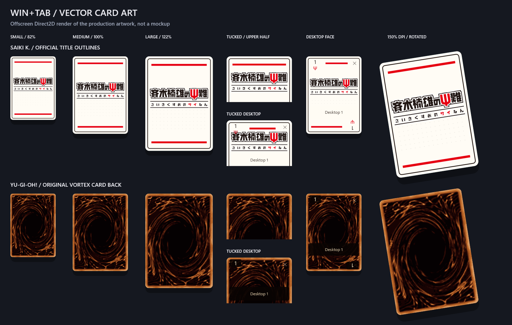

# OverhauldedWinTab

OverhauldedWinTab replaces Windows 11 Task View (`Win+Tab`) with a window
overview and a virtual desktop strip. Open windows from live previews, and
search or move windows and desktops without closing the overview.

## Controls

| Action | Keys |
| --- | --- |
| Open or close the overview | `Win+Tab` |
| Navigate | Arrow keys, or `h` `j` `k` `l` with Vim navigation |
| Cycle grid, held dock and desktop strip | `Tab` |
| Open the selected window or switch desktop | `Enter` |
| Search the current / all desktops | `/` / `?` |
| Switch desktop | `1`–`9`, `Ctrl+Left` / `Ctrl+Right` |
| Move the selected window | `Shift+1`–`Shift+9`, `Shift+Left` / `Shift+Right`, or `M` then a number |
| Hold or release a window | `U`, or right-click a window |
| Close a window or desktop | `Delete`, or middle-click a window |
| Rename or create a desktop | `F2` or right-click a tab; `N` or click the create tab |

Click a window to open it, click a desktop tab to switch, and scroll to page
through windows. `Esc` leaves search or the held dock first; a second press
closes the overview.

## Settings

- **Window tabs**: square previews or poker chips showing a live preview, app
  icon or title, in four sizes and several color modes.
- **Desktop strip**: flat or carousel layout with pill, chip or playing-card
  tabs, optional tucked cards, and create/close animations.
- **Card art**: built-in vector themes (Yu-Gi-Oh!, Pokémon, Kakegurui and Saiki
  K) or custom 2:3 portrait PNG/JPG faces. Use artwork you have permission to
  use.
- **Held windows**: keep windows with you across desktops, in the grid or in a
  left/right dock.
- **Theme**: built-in palettes (Catppuccin, Nord, Dracula) or custom colors,
  with Acrylic, Mica, Blur, solid or transparent backgrounds.
- **Other**: search visibility, shortcut hints, animation speed, wrap-around
  navigation and hover/selection lift.

Search by window title or app. All-desktop results show a `D#` label and use app
icons where live previews are unavailable; selecting one switches to its
desktop first.

## Compatibility

Windows 11 only. The overview appears on the active monitor. Mods that also
replace Task View or intercept `Win+Tab` may conflict.

`build.ps1` performs a local compile check; see
[docs/ARCHITECTURE.md](docs/ARCHITECTURE.md) for implementation details.

## License

MIT. See [LICENSE](LICENSE).
